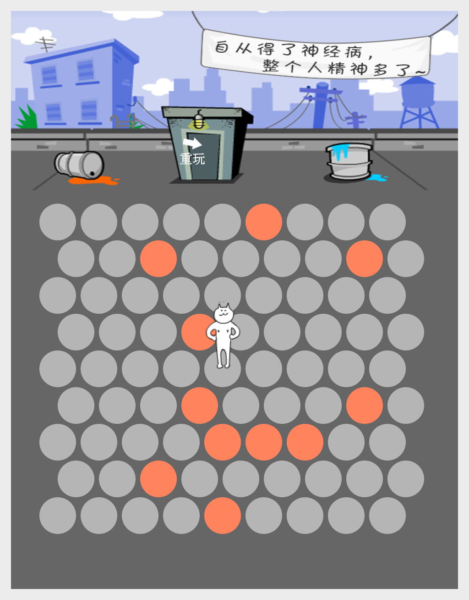

# PsychoCat - 围住神经猫



基于 [Slint](https://slint.dev) + C++ 复刻的经典小游戏「围住神经猫」。

点击空格放置路障，把小猫困在 9x9 六边形棋盘上；小猫每回合沿最短路朝边缘逃跑，走到棋盘边缘就轮到你输了。

## 玩法

- 点击空地放置路障，小猫随即用 BFS 最短路走一步（同级候选里倾向选择逃生口更多的一步）
- 围死小猫（六面被堵）即胜利，按步数获得称号；小猫逃到棋盘边缘则失败
- 游戏内「重玩」按钮或结算弹窗可再来一局

## 构建

依赖：CMake ≥ 3.21、C++17 编译器、Slint C++ 预编译包（放在 `third_party/slint/`，Windows/macOS 包从 [Slint Releases](https://github.com/slint-ui/slint/releases) 下载）。

```bash
cmake -S PsychoCat -B PsychoCat/build -DCMAKE_BUILD_TYPE=Release
cmake --build PsychoCat/build -j
./PsychoCat/build/PsychoCat        # Linux/macOS
```

Linux 需要额外安装 X11 相关开发包（见 `.github/workflows/release.yml` 中的 apt 列表）。

## 发布

推送后在 GitHub 上发布 Release，会触发 [CI](.github/workflows/release.yml) 自动构建 Windows / Linux / macOS (x64 + arm64) 的可执行文件并上传到该 Release。
